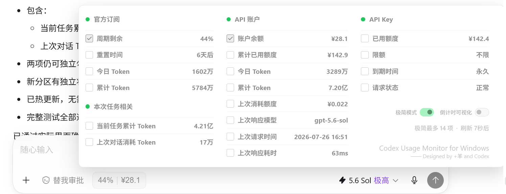
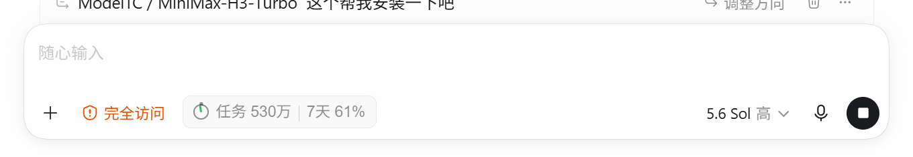
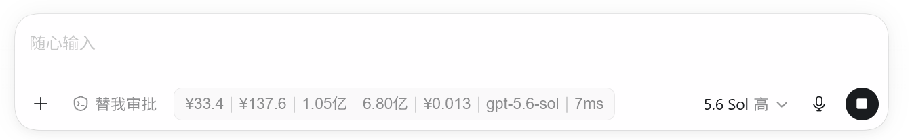

# Codex Usage Monitor for Windows

[](https://github.com/JiaYang-BUAA/Codex-Desktop-Usage-Monitor-Windows/releases/latest)
[](https://github.com/JiaYang-BUAA/Codex-Desktop-Usage-Monitor-Windows/actions/workflows/ci.yml)

**在 Windows 版 Codex 的输入框旁，看本周还剩多少额度、这次对话用了多少 Token。** 平时只占一条，默认显示「7 天剩余」和「当前会话累计 Token」。点开就能看重置时间、上次回答的缓存命中率，以及最近 30 天采集到的用量。

本项目是非官方项目。订阅额度由 Codex 返回；社区重置预测单独展示，仅供参考。



*上图为本机实拍，数值和勾选项取决于当时的账户与设置。*

## 值得常驻的几个理由

| 你想知道什么 | 在哪里看 |
| --- | --- |
| **额度能用到什么时候？** | 「官方订阅」把剩余百分比和对应窗口的重置时间放在一起。额度取自官方读数，不用 Token 数反推。 |
| **刚才那一轮用了多少？** | 「本会话」分别显示上次回答消耗 Token、上次回答缓存命中率和整段对话的总缓存命中率。新回答生成期间，仍显示上一轮已完成的结果。 |
| **哪几天用得最多？** | 打开「官方订阅 → 用量历史」，在今日、7 天、30 天之间切换。柱状图看本机采集到的订阅 Token，曲线看官方剩余额度；没有采样的时段留空。 |
| **同时开两个任务，会串数吗？** | 在同一 Codex 实例中，每个窗口跟随自己的任务，独立显示 Token、执行总耗时、自动压缩上下文次数和续跑状态；账号额度共享。 |
| **长任务因为额度耗尽停了怎么办？** | 可以只为这个任务开启「额度恢复续跑」。监视器确认任务仍因额度耗尽而暂停，且官方额度已恢复，才向原对话发送「继续」或自定义内容。默认关闭，不占用输入框，不覆盖排队消息。 |

## 1. 三步开始使用：让 Codex 帮你安装

1. 在已登录的 Windows 版 Codex 中，复制下面这句话：

   ```text
   请帮我安装 https://github.com/JiaYang-BUAA/Codex-Desktop-Usage-Monitor-Windows 的最新正式版，按仓库 AGENTS.md 操作，验证桌面快捷方式，保留当前 Codex 会话。
   ```

2. 安装完成后，**正常退出 Codex**。
3. 从桌面的 **Codex Usage Monitor** 快捷方式重新打开。它会一起启动 Codex 和监视器；从原生 Codex 图标启动不会开启监视端口。

只看官方订阅和会话用量，**不需要 API Key**。支持 Windows 10/11、Microsoft Store 和非 Store 版 Codex；需要 Node.js 22+，推荐 PowerShell 7。

## 把常看的数字留在输入框旁

点击监视条展开面板，勾选想常看的指标。**勾选顺序就是从左到右的显示顺序**；取消后重新勾选即可把一项移到末尾。在「官方订阅 → 设置」里可以切换模式：

| 普通模式：保留名称，最多 8 项 | 极简模式：只看数值，最多 14 项 |
| --- | --- |
|  |  |

监视条跟随 Codex 任务和 ChatGPT Work 输入区；普通 ChatGPT 聊天、Dot 面板和 Dot 指派的任务不显示。设置里还可以切换中英文、倒计时可视化，以及将官方订阅和 API 的刷新间隔从 60 秒调为 30 秒。

**读数怎么看：**

- **额度和 Token 是两种统计。** 5 小时、7 天剩余是账户额度；「今日 Token」统计本机订阅用量，「近7天 Token」和累计值以官方汇总为基准。官方汇总延迟不等于额度耗尽。识别为 Pro 时，当前版本的 5 小时项显示 `--`，重置时间看 7 天窗口。官方栏红灯表示本轮读取失败，有上次成功值时会保留它。
- **社区预告和账户重置分开看。** 可选的预测栏每 5 分钟更新 [Codex Reset Observatory](https://github.com/gussuri/codex-reset-observatory) 的社区概率、重置预告和 Tibo 最新公开动态。预测不参与自动续跑。
- **第三方 API 按需开启。** 两个 API 栏默认隐藏。「API 账户」看账户余额和请求日志；「API Key」看单个密钥的限额、到期时间和请求状态。需服务商提供用量接口，密钥在本机表单内填写，由 Windows DPAPI 加密保存，不要发到聊天里。

## 文档与维护

- [数据源与指标说明](docs/data-sources.md)：Token 统计口径、缓存命中率、历史图采样、续跑条件和第三方接口配置。
- [故障排查指南](docs/troubleshooting.md)：快捷方式启动失败、没有监视条、读数过期或设置未保存。
- v3.2.4 恢复了新版 Codex Desktop 上的额度续跑，修复了切换账号后的旧读数和多窗口设置冲突。可在设置中开启自动更新，更新监视器无需重启 Codex。[更新日志](CHANGELOG.md) · [下载正式版](https://github.com/JiaYang-BUAA/Codex-Desktop-Usage-Monitor-Windows/releases/latest)

<details>
<summary>手动安装、API 配置与技术细节</summary>

手动安装：从正式版页面下载并解压 Windows ZIP，运行 `pwsh -NoProfile -File .\install.ps1`，再正常退出 Codex，从桌面专用快捷方式启动。[AGENTS.md](AGENTS.md) 包含安装和验证说明。

API 账户首次配置需要服务地址、数字用户 ID、账户访问令牌和累计 Token 基准；API Key 的服务地址和字段映射可在[配置面板](docs/images/configure-api-key.png)填写。社区动态取自上游响应的 `latestTiboActivity` 字段，无需登录 X。

监视器只通过本机回环地址连接 Codex，不修改 WindowsApps、`app.asar`、登录文件或模型配置。安全软件：项目使用隐藏 PowerShell、Node.js 后台进程和 CDP 参数，可能触发启发式误报。确认安装包来自本仓库后，为项目目录、启动脚本或相关进程添加精确信任规则，或者直接关闭杀毒软件。

</details>

## 来源与贡献

项目的运行时注入思路源自 [Fei-Away/Codex-Dream-Skin](https://github.com/Fei-Away/Codex-Dream-Skin)。由 [+羊（@JiaYang-BUAA）](https://github.com/JiaYang-BUAA) 发起和维护，[Codex（@codex）](https://github.com/codex) 协作开发。代码采用 [MIT License](LICENSE)，第三方说明见 [NOTICE.md](NOTICE.md)。
